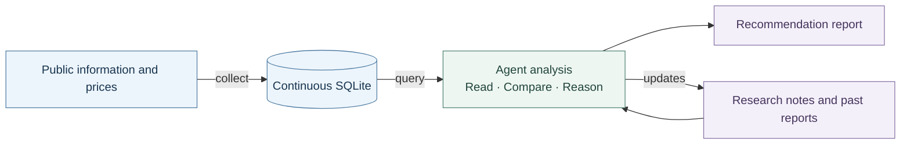

<div align="center">

<h1>MarketSift</h1>
<p><strong>Connect history. Interpret change. Make reasoned choices.</strong></p>
<p>Continuous market evidence for agent-led research.</p>

<p>
  <a href="pyproject.toml"></a>
  
  <a href="LICENSE"></a>
</p>

<p>
  <a href="README.zh-CN.md">简体中文</a> &nbsp;·&nbsp;
  <a href="#install">Install</a> &nbsp;·&nbsp;
  <a href="#main-commands">Commands</a> &nbsp;·&nbsp;
  <a href="#research-workflow">Workflow</a> &nbsp;·&nbsp;
  <a href="skills/market-research/SKILL.md">Agent Skill</a>
</p>

</div>

---

MarketSift stores public texts, market observations and product references in **one SQLite database**. An agent reads and compares the evidence, considers what may happen next, writes recommendations and continues the research through ordinary notes. The tool collects, connects and calculates; the agent forms the judgments.

| A-share | OKX | Macro & public information |
| :--- | :--- | :--- |
| Information and prices | Products and market data | Macro series, news and forums |

Availability and returned scope depend on the request. Operational and source details live in the [project Skill](skills/market-research/SKILL.md).

## Install

From the project root, using [uv](https://docs.astral.sh/uv/):

```sh
uv sync --locked --no-dev
uv run --locked --no-sync marketsift --help
```

> **Already set up?** Reuse `.venv/Scripts/marketsift.exe` on Windows or `.venv/bin/marketsift` elsewhere. The examples below use uv to invoke that same project entry point.

## Main commands

| Command | Purpose |
| :--- | :--- |
| `sources` | Inspect connected source capabilities and parameters |
| `collect` | Explicitly fetch and store observations |
| `query` | Read, relate and calculate over local evidence |

```sh
uv run --locked --no-sync marketsift sources
```

<details>
<summary><strong>Collection examples · A-share and OKX</strong></summary>

**A-share names, information and prices**

```sh
uv run --locked --no-sync marketsift collect --source cninfo
uv run --locked --no-sync marketsift collect --source sina --since 2026-11-03T09:00+08:00 --until 2026-11-03T11:00+08:00
uv run --locked --no-sync marketsift collect --source tdx --instrument SH600000 --instrument SZ000001 --since 2026-11-03T09:30+08:00 --until 2026-11-03T11:00+08:00
```

**OKX prices**

```sh
uv run --locked --no-sync marketsift collect --source okx --dataset prices --instrument OKX:SPOT:BTC-USDT --since 2026-11-03T08:00Z --until 2026-11-03T10:00Z
```

Dates are fixed historical examples; replace them with the intended range and retain UTC offsets.

</details>

Default storage is `data/marketsift.sqlite`; use `--database <path>` to select another database. Collect updates into that same database to retain revisions and acquisition history. Later source failures preserve already committed batches.

Let the agent compose queries using the Skill, or run `uv run --locked --no-sync marketsift query --spec query.json` with a UTF-8 query file you have prepared. The CLI also accepts stdin. Query reads an existing database and reports a missing one as an error.

→ [API reference and copyable examples](skills/market-research/references/api.md)

## Research workflow



Load [the research Skill](skills/market-research/SKILL.md), then ask, for example:

> Continue the existing research on Shanghai/Shenzhen mainboard stocks. Collect information and prices since the last cutoff, compare history, peers and competing directions, and give a concise selection with reasons, entry/exit rationale and evidence that would overturn it. Save the report and update the watch notes.

You can also ask about BTC/ETH or a specific holding. The agent considers the actual market and product conditions; provide current entry details and sellable-position facts when asking about holdings.

The agent connects earlier judgments with new evidence, collects gaps, reads original texts and compares responses. **Theme or direction, instrument choice and participation timing** receive separate reasons. New feedback informs the next review; previous reports retain their original judgments.

`research/current.md`, relevant watch notes and `research/reviews/` are ordinary files maintained directly by the agent. The tool does not execute trades; research keeps data gaps and unread content explicit. Agent references are written in Chinese, with API names preserved.

| Read next | Find |
| :--- | :--- |
| [Source reference](skills/market-research/references/sources.md) | Evidence scope and source selection |
| [A-share](skills/market-research/references/a-share.md) | A-share market conditions |
| [OKX / macro](skills/market-research/references/okx-macro.md) | Product and macro relationships |

## Development

```sh
uv sync --locked
uv run --locked --no-sync pytest -q -p no:cacheprovider
uv run --locked --no-sync ruff check --no-cache --select F,I,RUF100 src tests
```

The runtime package is `src/marketsift/`, using HTTPX and turbohtml. Data, research and development records stay local by default. Read-only continuation from an old database or ordinary material is described in the [API reference](skills/market-research/references/api.md#按需求取得资料).

---

[MIT](LICENSE) covers project code and documentation. Third-party content retains its own rights.
