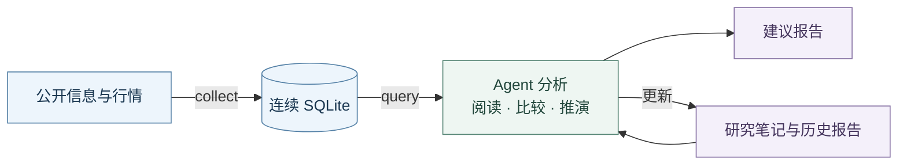

<div align="center">

<h1>MarketSift</h1>
<p><strong>联系历史，理解变化，形成有依据的选择。</strong></p>
<p>为 Agent 研究提供连续的市场资料。</p>

<p>
  <a href="pyproject.toml"></a>
  
  <a href="LICENSE"></a>
</p>

<p>
  <a href="README.md">English</a> &nbsp;·&nbsp;
  <a href="#安装">安装</a> &nbsp;·&nbsp;
  <a href="#主要用法">主要用法</a> &nbsp;·&nbsp;
  <a href="#研究工作流">工作流</a> &nbsp;·&nbsp;
  <a href="skills/market-research/SKILL.md">研究 Skill</a>
</p>

</div>

---

MarketSift 将公开原文、行情和产品参考直接保存到**同一 SQLite**。Agent 阅读和比较这些资料，推演后续变化，写出建议，并用普通文件接续研究。工具负责取得、关联与计算，研究判断由 Agent 完成。

| A股 | OKX | 宏观与公开信息 |
| :--- | :--- | :--- |
| 信息与行情 | 产品与市场数据 | 宏观序列、新闻与论坛 |

来源的实际返回范围和可用性随请求而异，详细操作与资料口径统一放在[项目 Skill](skills/market-research/SKILL.md)中。

## 安装

在项目根目录，使用 [uv](https://docs.astral.sh/uv/)：

```sh
uv sync --locked --no-dev
uv run --locked --no-sync marketsift --help
```

> **已有环境？** 沿用即可：Windows 可直接运行 `.venv/Scripts/marketsift.exe`，其他平台用 `.venv/bin/marketsift`。以下示例使用 uv 调用同一项目入口。

## 主要用法

| 命令 | 用途 |
| :--- | :--- |
| `sources` | 查看已适配来源与参数 |
| `collect` | 显式采集并保存资料 |
| `query` | 从本地资料读取、关联和计算 |

```sh
uv run --locked --no-sync marketsift sources
```

<details>
<summary><strong>展开采集示例 · A股与 OKX</strong></summary>

**A股名称、信息与行情**

```sh
uv run --locked --no-sync marketsift collect --source cninfo
uv run --locked --no-sync marketsift collect --source sina --since 2026-11-03T09:00+08:00 --until 2026-11-03T11:00+08:00
uv run --locked --no-sync marketsift collect --source tdx --instrument SH600000 --instrument SZ000001 --since 2026-11-03T09:30+08:00 --until 2026-11-03T11:00+08:00
```

**OKX 行情**

```sh
uv run --locked --no-sync marketsift collect --source okx --dataset prices --instrument OKX:SPOT:BTC-USDT --since 2026-11-03T08:00Z --until 2026-11-03T10:00Z
```

日期是固定历史示例，实际使用换成目标时段并保留时区。

</details>

默认库为 `data/marketsift.sqlite`，可用 `--database <路径>` 指定。更新时继续采集到同一库，保留事实修订及取得记录；后续来源失败也保留已提交批次。

让 Agent 按 Skill 组织查询，或用 `uv run --locked --no-sync marketsift query --spec query.json` 读取你准备的 UTF-8 查询文件。CLI 也支持 stdin；query 只读已有库，缺库时明确报错。

→ [完整 API 与可复制示例](skills/market-research/references/api.md)

## 研究工作流



让 Agent 加载[研究 Skill](skills/market-research/SKILL.md)，例如：

> 接续已有研究，复盘沪深主板。补采截止后的信息和量价，联系历史、同组与竞争方向，给出精简选择、放弃理由、参与和退出依据，以及推翻判断的证据。保存报告并更新关注记录。

也可以要求研究 BTC/ETH 或具体持仓。Agent 会根据市场与产品条件分析；涉及持仓时提供当时的买入、可卖数量等事实。

Agent 从旧判断和新证据出发，按需补采、读原文、关联对象并比较量价，分别判断**主题方向、产品选择和参与时机**。关键反馈进入下一轮研究，旧报告保留当时判断。

`research/current.md`、所需关注笔记与 `research/reviews/` 是 Agent 直接维护的普通文件。工具不执行交易，资料缺口和未读内容随研究说明。

| 继续阅读 | 内容 |
| :--- | :--- |
| [来源参考](skills/market-research/references/sources.md) | 来源选择与资料范围 |
| [A股](skills/market-research/references/a-share.md) | A股市场条件 |
| [OKX / 宏观](skills/market-research/references/okx-macro.md) | 产品与宏观关系 |

## 开发

```sh
uv sync --locked
uv run --locked --no-sync pytest -q -p no:cacheprovider
uv run --locked --no-sync ruff check --no-cache --select F,I,RUF100 src tests
```

运行包位于 `src/marketsift/`，依赖 HTTPX 和 turbohtml。数据、研究和开发记录默认本地保留；旧库与普通资料的只读接续方法见[API 参考](skills/market-research/references/api.md#按需求取得资料)。

---

[MIT](LICENSE) 覆盖项目代码和文档，第三方内容保留原权利。
